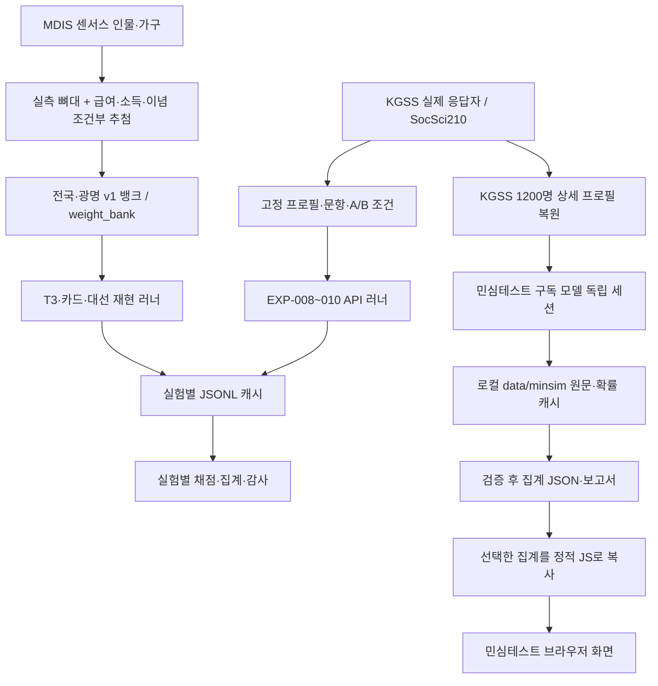

# IDEA 현재 구현 구조 분석 — 2026-09-22

분석 기준: GitHub `main` / 로컬 기준 커밋 `2e4f3d6`(원격 대조 확인).

분석 범위: [AGENTS.md](../../AGENTS.md), [docs/7_이슈트래킹/ISSUES.md](../../docs/7_%EC%9D%B4%EC%8A%88%ED%8A%B8%EB%9E%98%ED%82%B9/ISSUES.md), [docs/2_전략기획/구현계획_v1.md](../../docs/2_%EC%A0%84%EB%9E%B5%EA%B8%B0%ED%9A%8D/%EA%B5%AC%ED%98%84%EA%B3%84%ED%9A%8D_v1.md), `src/engine/` 전 모듈, phase0 핵심 소스/기존 진단, 실험별 주요 prep/runner/scorer, 데이터 레지스트리·매니페스트. **소스와 저장된 문서만 읽었으며 새 생성·LLM 호출·재채점은 하지 않았다.** 아래 구현 상태는 소스 확인 결과이며 신규 성능검증 결과가 아니다.

## 1. 현재 무엇이 있는가

현재 IDEA 연구 코드는 **Python 모듈 8개와 실험별 스크립트/JSONL 파일의 집합**이다. 하나의 통합 예측 API 서버, 학습 완료 모델, 자동으로 최신 전국 여론을 추론하는 제품 엔진으로 이해하면 안 된다.

- [src/engine/registry.py](../../src/engine/registry.py): 원자료 논리명 → 경로 → 선택적 SHA-256 검증.
- [src/engine/harmonize.py](../../src/engine/harmonize.py): 연령·학력·주거·지역 코드 정합/표현용 라벨.
- [src/engine/tables.py](../../src/engine/tables.py): 실측 자료에서 조건부 분포를 만들고 부족한 셀은 낮은 해상도로 폴백.
- [src/engine/bank.py](../../src/engine/bank.py): 센서스 실레코드 샘플링 + 조건부 추첨 → 페르소나 JSONL.
- [src/engine/prompts_t3.py](../../src/engine/prompts_t3.py): EXP-004 A/B/C 프롬프트와 페르소나별 후보 순서.
- [src/engine/prompts_ab.py](../../src/engine/prompts_ab.py): EXP-005/007 신념 카드·후보 프로필 프롬프트.
- [src/engine/llm_client.py](../../src/engine/llm_client.py): OpenAI/NVIDIA 접속, 일부 러너 컷오프 게이트, RPM 제한, k-샘플링.
- [src/engine/__init__.py](../../src/engine/__init__.py): 패키지 시작점.

세 개 계보를 구분해야 한다.

1. **합성 인구 뱅크 계보**: MDIS 센서스 뼈대 + 급여/소득/KGSS 이념 추첨 → 전국 5,000·광명 4,568 뱅크 → EXP-004/005/007/012 대선 재현.
2. **실제 설문 응답자 계보**: KGSS 응답자 자체를 인물로 삼아 미제공 문항이나 A/B 문항을 물음(EXP-008/009/010). 미국은 SocSci210 연구 응답자 인구속성. 이것은 뱅크 재가중으로 만든 가상 광명 인구와 다르다.
3. **민심테스트 계보**: KGSS 상세 응답을 복원한 1,200명에 신규 생활 질문을 묻고 정적 웹에 이미 계산된 집계를 표시. 별도 Codex 구독 백엔드; API 연구 러너와 다르다. 이 계보의 상세 구현은 [민심테스트/README.md](../../%EB%AF%BC%EC%8B%AC%ED%85%8C%EC%8A%A4%ED%8A%B8/README.md), 관련 스크립트·EXP-014~017 및 별도 제품 분석을 함께 보아야 한다.

### 현재 데이터 흐름

사용자 자유 질문에서 I로 이어지는 서버 경로는 없다. L의 일부 SSR 채점은 임베딩 API를 호출하므로 전부 오프라인으로 표시하지 않았다. 계획 중인 PPI/레이킹·지역 전이 본실험은 이 실행 완료 흐름에 포함하지 않았다.

## 2. 페르소나 뱅크: 자료 → 조건부 분포 → 인물 카드

### 2.1 원자료와 기준 연도

[data/registry.json](../../data/registry.json)에 다음 논리 데이터가 등록되어 있다.

| 논리명 | 재료/규모(등록값) | 쓰임 |
|---|---|---|
| `census_2020_2pct_person` | MDIS 2020 인구 2% 표본, 926,967행 | 인물 뼈대, 성인 18+ 추출 |
| `census_2020_2pct_household` | 같은 센서스 가구주택, 418,594행 | 가구일련번호 조인으로 점유형태/거처 보완 |
| `laf_2025h1_a` | 지역별고용조사 2025 상반기 A형, 403,875행 | 임금근로자의 조건부 급여 구간 |
| `sflc_2025_master` | 가계금융복지조사 2025, 18,664가구 | 가구소득 10분위 |
| `kgss_cum_2003_2025` | KGSS 누적 V2, 23,282케이스 | 신념/이념·상세 실측 응답 |
| `socsci210` | SocSci210 parquet 디렉터리, 2,901,390행 | 미국 무작위 실험 쌍·인구속성 |

따라서 뱅크의 기본 인구구조는 **2020 센서스 성인 구조**다. 2025 보완 자료를 결합했다고 해서 최신 주민등록 인구와 동등한 전국대표성이나 선거 유권자 모집단 타당성이 자동으로 확보되는 것은 아니다. 자료별 연도·단위가 혼합되어 있으며 이는 `provenance`에 일부 기록된다.

`registry.data_dir()`는 `IDEA_DATA_DIR` 환경변수, 없으면 저장소 `data/`를 사용한다. `resolve(name, verify=False)`는 경로 존재를 확인하고, `verify=True`일 때만 등록 해시를 검사한다. `bank.load_tables(verify=...)`에서 MDIS CSV에는 verify가 전달되나 KGSS `resolve`에는 전달되지 않는다. 현재 레지스트리 KGSS 경로는 `data/kor_data_CUM0074_V2.sav`; 구문서/옛 스크립트의 `data/raw/kor_data_CUM0074_V2.sav`와 구분해야 한다.

### 2.2 정합화의 실제 범위

[harmonize.py](../../src/engine/harmonize.py)는 연령을 `18-29/30대/40대/50대/60대/70+`, 학력을 `중졸이하/고졸/전문·대졸/대학원이상`으로 통일한다. 센서스, LAF, KGSS의 서로 다른 학력 코드마다 별도 변환 함수가 있다. KGSS 이념 조회는 시도 17개를 7권역으로 바꾼다.

행정지역 전체 상호변환 테이블이 완성된 것은 아니다. `CENSUS_TO_LAF_SIGUNGU`에는 **광명 `(31, 060) → 3106` 한 건만** 검증 등록되어 있다. 전국의 다른 시군구는 급여 조회 L1 대신 시도 이하 폴백을 탄다. `data/mappings/`는 현재 저장소에 없다. 데이터 매니페스트에도 일반 코드 매핑표는 후속 과제로 남아 있다.

### 2.3 표집과 가중치

`bank.load_pool()`은 인구 CSV와 중복 제거 가구 CSV를 `가구일련번호`로 조인하고 18세 이상만 남긴다.

- 전국 본뱅크: 시도 인구가중값 합계 비례로 n=5,000 배정, 각 시도 최소 200명을 보장. 시도 내부는 `인구가중값` 확률로 비복원 추출한다.
- 전국 `weight_bank`: `(시도 인구 비중)/(시도 표본 비중)`. 소형 시도 최소 200명 할당에 따른 과대표집을 집계 시 복원한다.
- 광명 본뱅크: 성인 표본 4,568명 전체 사용. `weight_bank = 인구가중값/광명 평균 인구가중값`.
- 광명 표집 모드: PPS 추출 뒤 `weight_bank=1`.
- `weight_person`은 원 센서스 값의 보존 필드이고, 본뱅크 결과 집계는 **`weight_bank`**를 사용한다(ISS-016). 둘을 다시 곱하면 이중가중이다.

`persona_id` 형식은 `{NA|GW}-{tag}-{seed}-{index}`이고, `skeleton`, `drawn`, `weight_person`, `weight_bank`, 자연어 `card`, `provenance`를 가진다. `skeleton`에는 시도/시군구·성·연령·학력·혼인·고용·직업·산업·통근·점유·거처·가구번호가 있다.

저장 경로는 `data/banks/persona_bank_{national|gwangmyeong}_v1.jsonl`. `v0`는 감사 전 프로토타입이므로 후속 연구에 쓰지 않는다는 기존 지침을 유지한다. `validation_v1.json`은 **인구구성 마진 검증 산출물**이지 여론 예측 성능 검증이 아니다.

### 2.4 세 가지 조건부 조회표

`CascadeTable.fit()`은 각 셀에서 범주별 가중합과 레코드 수를 저장한다. `draw()`는 최소 레코드 수를 만족하는 가장 세밀한 셀부터 확률로 한 값을 추첨한다. 최빈값으로 고정하지 않는다.

| 표 | 실제 폴백 순서 | 최소 셀 |
|---|---|---|
| 임금 W | 시군구×연령×성 → 시도×연령×성×학력 → 시도×연령×성 → 전국×연령×성 | 30 |
| 가구소득 I | 수도권여부×연령10×학력3×점유4 → 수도권×연령×점유 → 수도권×연령 → 전국 | 30 |
| 이념 K | 권역7×성×연령×학력 → 성×연령×학력 → 연령 → 전국 | 5 |

- W는 양의 급여를 가진 18+ 임금근로자 자료로 추정하고, 페르소나가 임금근로자일 때만 부여한다.
- I는 가구주 연령/학력 기반의 가계금융복지조사 조회표를 각 인물 카드에 적용한다. 인물과 가구주의 대응이 항상 직접 관측되는 통합 마이크로데이터는 아니다.
- K는 최신 3파동(현재 2021/2023/2025)의 `PARTYLR` 1~5와 DK=0을 사용한다. 조회표의 KGSS 각 행 가중치는 1.0이다.
- 여러 원자료의 속성을 각각 조건부로 추첨하므로 **모든 속성의 고차원 결합분포까지 보존한 것은 아니다**. 후속 도너 연구가 이 한계를 다룬다.
- `--ideology dev`가 기본값이며 인간 이념 라벨 검증 게이트 전 개발용 상태를 명시한다. `off`는 이념 문장을 제외한다. 현재 소스에 실제 인간 κ 검증을 자동 판정하는 완성된 게이트는 없다.

`render_card()`는 위 필드를 문장화한다. LLM으로 임의 생활서사를 발명하는 것이 아니다. 단 원자료 자체에서 직접 관측한 속성과 다른 자료의 조건부 추첨값을 해석상 구분해야 한다.

## 3. API 백엔드와 캐시

### 3.1 모델·접속

[llm_client.py](../../src/engine/llm_client.py)는 OpenAI 호환 SDK를 공통으로 사용한다. OpenAI는 기본 endpoint, NVIDIA는 `https://integrate.api.nvidia.com/v1`.

- 유료 대선 기준 모델 키 `gpt-4o-mini`는 실제 호출 ID `gpt-4o-mini-2024-07-18`, 등록 컷오프 2023-10.
- EXP-007은 `meta/llama-3.1-70b-instruct`; 파일 주석/ISS-024에 2026-08-26 EOL 기록.
- EXP-009/010 미국 실제 후속 기준은 `meta/llama-3.2-90b-vision-instruct`, 등록 컷오프 2023-12.
- 공통 기본값은 아직 `llama-3.3-70b`, 옛 [exp008_run.py](../../scripts/exp008_run.py)·[exp009_us_run.py](../../scripts/exp009_us_run.py) 기본값은 `llama-3.1-70b`다. **기본값이 최신 사용 가능 모델을 의미하지 않는다.** 가용성은 이번에 외부 재검증하지 않았다.
- API 키는 환경변수 또는 gitignore된 `API.txt` 등으로 로드한다. 실제 키 내용은 분석에서 읽거나 문서화하지 않았다.

`assert_cutoff()`는 고정 대선일 2025-06-03의 월과 모델 컷오프를 비교한다. 불명·동월 이후·비1차근거는 차단하며 명시적 위험 허용은 `MEMORIZATION_RISK`를 반환한다. T3/AB 공통 resolver, EXP-012는 이를 호출하지만 EXP-008/009/010은 직접 `make_client()`를 사용한다. 따라서 **모든 실험·문항 날짜에 컷오프를 일반적으로 강제하는 통합 하네스는 아직 없다.** 설문연구 자체의 시점·공개일 오염은 개별 사전등록·프로브 기록을 함께 확인해야 한다.

### 3.2 샘플링·레이트 제한

공통 `Sampler`는 temperature=1, k=5, max_tokens=300 기본이다. OpenAI API `n=k` 한 요청을 먼저 시도하고 미지원/불완전이면 독립 k회 요청으로 폴백한다. 코드의 `n_mode="batch"`는 **Chat Completions 한 요청의 복수 choices**를 뜻한다. 할인되는 비동기 **Batch API** 구현이 아니다.

`RateLimiter`는 프로세스 내 스레드 락 기반 호출 간격 조절이며 429 때 전역 다음 호출 시점을 지연한다. 서로 다른 프로세스 전체를 묶는 계정 단위 제한기는 아니다. 여러 러너를 동시에 켜면 합산 제한을 넘을 수 있다. 기존 운영 기록은 무료 러너 한 개, `concurrency 12/rpm 25`가 안전했다고 설명하나 EXP-010 등은 별도 설정을 사용하므로 이를 보편 한도로 단정하면 안 된다.

EXP-008 이후는 공통 `Sampler` 대신 각 파일에서 ThreadPool·6회 재시도·파서·통계 집계를 구현한다. FULL 프로필은 입력이 길어 RPM/병렬도를 낮춘 별도 단계로 처리한다. EXP-010 NVIDIA에는 timeout=2400초도 있다.

### 3.3 캐시와 재개 보장의 한계

공통 패턴은 JSONL 한 줄씩 append/flush하고 다음 실행에서 성공 ID만 건너뛰는 것이다.

- T3/AB: 암·모델 tag별 파일, persona_id 기준 성공 판정. 에러가 없으면 파싱 여부와 무관하게 완료로 취급한다.
- EXP-008: `(pid, arm, var)`.
- EXP-009 한국: `item|arm|form|pid|rep`.
- EXP-009 미국: `study|cond|persona|rep`.
- EXP-010: 한국 `item|arm|form|pid`, 미국 `study|cond|persona`; 채널은 파일명으로 분리.
- EXP-012: `arm|persona_id`.

이것은 **중단 뒤 동일 설정 재개**를 돕지만 T1 계획의 `hash(모델+파라미터+system/user 프롬프트)` 무효화 캐시·SQLite가 아니다. 같은 파일에서 모델, 프롬프트, 선택지, k를 바꾸면 기존 ID 성공분을 재사용하거나 다른 설정 결과를 섞을 수 있다. 자동 provenance manifest도 실험별로 불균일하다. 특히 EXP-008/009/010은 `--model`이 있지만 output 파일/키에는 모델이 없다. 소스 읽기만으로 확인된 실패 조건이며 현재 데이터가 실제로 섞였다고 결론내린 것은 아니다.

또한 모든 raw 파일이 문자 그대로 원문 전체를 보존하는 것은 아니다. T3/AB는 `samples` 문자열, EXP-009는 파싱된 `pred`, EXP-010 dist는 정규화된 `dist`, SSR만 `text`를 저장한다. EXP-012도 후보명→확률만 저장한다. 파서 이전 전체 응답, 실사용 프롬프트 해시, 정확한 호출 파라미터 보존은 공통 보장되지 않는다.

**실행 주의:** [scripts/exp010_kr_score.py](../../scripts/exp010_kr_score.py)는 이름이 scorer지만 `ssr_embed_once()`에서 OpenAI `text-embedding-3-small`을 실제 호출한다. 문서/캐시를 읽는 대신 실행해 확인하면 API 0콜이 아니다. [exp010_meter_compare.py](../../scripts/exp010_meter_compare.py), [exp010_ssr_rate.py](../../scripts/exp010_ssr_rate.py), [exp010_pre_embed.py](../../scripts/exp010_pre_embed.py)도 외부 모델/임베딩 호출 여부를 확인해야 한다. prep/scorer 여러 파일은 `if __name__` 보호 없이 최상위 코드에서 실행되므로 단순 import도 읽기 전용이 아닐 수 있다.

## 4. 실험 파이프라인별 현재 동작

### 4.1 Phase 0 — 역사적 기준선

[phase0/phase0_run.py](../../phase0/phase0_run.py):

1. Hugging Face `nvidia/Nemotron-Personas-Korea`를 내려받아 shuffle(seed=42), 앞 50,000명 사용.
2. 권역 배분 × 권역 안 연령5×성2 균등으로 약 1,000명(기록상 1,027명) 추출.
3. 생성 서사 + 지역/세대 정치 성향 통계 + 양당 90%·군소 억제 지시 + 자기 이념 진단 → 후보 선택.
4. `gpt-4o-mini` alias, temp .7, k5, 8병렬.
5. 전체 작업 완료 후 JSONL/메타 저장.
6. [phase0_analyze.py](../../phase0/phase0_analyze.py)는 개인 k5를 최빈값 한 표로 축약하고 기권 제외 후보 비중/시도 1위를 채점.

현행 규칙에 맞는 기본 경로가 아니라 **자책골·최빈값 수축·표집 결함을 드러낸 실패 기록**이다. 레거시 [run_experiment.py](../../phase0/run_experiment.py)는 Anthropic·2020 총선 실험안이고, 현재 주 파이프라인이 아니다. [build_ground_truth.py](../../phase0/build_ground_truth.py)는 `/sessions/...` 절대경로를 남긴 레거시 정답지 생성기다. 현행 후속 대선 scorer는 이미 저장된 [phase0/data/ground_truth_2025.json](../../phase0/data/ground_truth_2025.json)을 계속 읽는다.

### 4.2 EXP-004 — 위생수리 A/B/C

[run_t3_pilot.py](../../scripts/run_t3_pilot.py)는 전국 v1 뱅크에서 seed=42로 1,000명을 추출하고 ID를 [data/t3/subsample_ids_1000.json](../../data/t3/subsample_ids_1000.json)에 저장한다.

- A: phase0 힌트/억압/고정 순서/강제선택을 이식한 대조군.
- B: 집계 힌트와 억압 삭제, 후보만 페르소나별 순서 랜덤화; 기권 포함, 자기 이념 진단은 남음.
- C: B에 답변 비공개/DK 선택지 추가.

[score_t3.py](../../scripts/score_t3.py)는 각 반복 응답에 `weight_bank/k`를 부여해 분포를 보존한다. 후보 질량을 합한 뒤 유효표 분모로 정규화하며 기권/DK/파싱 실패는 별도 보고한다. MAE·최대오차·1/2위 마진오차·이준석 raw 수·시도 1위 적중을 계산한다. 시도는 여전히 이름 매핑 사전을 쓰며 완전한 행정코드 정답지 하네스는 아니다.

A→B→C 차이를 소스/프롬프트/강제선택/잔여 성분으로 해석한 기존 보고가 있으나, 여러 요소가 같이 바뀌므로 각 심리 메커니즘의 순수한 단일 인과효과로 과도하게 읽지 않는다.

### 4.3 EXP-005/007 — 이념 라벨과 도너 신념 카드

[build_belief_cards.py](../../scripts/build_belief_cards.py)/[build_belief_cards_v2.py](../../scripts/build_belief_cards_v2.py)는 KGSS 한 명의 여러 응답을 통째로 복사하는 hot-deck를 사용해 카드 안 문항 간 상관을 보존한다. donor PARTYLR은 진단용이며 렌더링하지 않는다.

- D: B의 명시적 이념 문장 제거, 도너 신념 문장으로 대체.
- E: 원 B 카드 유지, 모든 후보에 같은 형식의 경력/직업 정보 추가.
- D2A/D2B: 동일 도너 5문항 `UNIFI/CONBUS/SATFIN/GOVSPD6/GOVSPD7`, 단정 톤/과거 설문 응답 완화 톤 비교.

[run_ab_cards.py](../../scripts/run_ab_cards.py)는 EXP-004의 동일 1,000 ID·후보 순서를 사용한다. 모델이 바뀌면 B도 함께 돌려 해당 모델 안의 paired 대조를 만든다. [score_ab.py](../../scripts/score_ab.py)는 topline뿐 아니라 카드 이념→자가진단 유지율, 진보→보수/보수→진보 크로스보팅, 중도→김문수 비중 등 매핑 병리를 본다. 이 카드들은 실험에서 기각된 설계이며 현재 검증된 표준 처방으로 사용하면 안 된다.

### 4.4 EXP-008 — 상세 실제 응답이 개인 예측을 돕는가

[exp008_prepare.py](../../scripts/exp008_prepare.py)는 KGSS 2023에서 5영역×2문항=10문항 배터리를 결정 규칙으로 선정한다. 유효 배터리 응답 8개 이상인 사람 중 seed 42로 300명을 평가셋에 고정한다. 나머지 2023 응답자와 2021/2025 응답자는 참조셋이며 평가 대상의 배터리 정답은 학습 입력에서 제외한다.

- K0: 인구속성만.
- K5: 영역을 나눈 실측 응답 5개.
- FULL: 허용된 상세 실측 응답 전체.
- SHUF: 같은 인구 셀 비평가 도너의 응답으로 교체. 인구조건/문항 슬롯/순서를 최대한 유지하면서 개인 신호를 검증.

프로필 제외: 정치·투표·정당/이념, 인구/관리 변수, 배터리 자체, 상관 |r|≥.85 준중복. 출력 `profiles.jsonl`, `reference.parquet`, `prep_meta.json`, `battery_table.txt`.

러너는 한 사람×한 암×한 문항당 한 번 강제선택 호출한다. scorer는 릿지(상관 상위20, λ10), kNN10, 반복 SVD(rank20), 성×연령 셀 최빈값과 비교한다. 평가 배터리는 마스킹한 채 참조셋 기반 예측한다. 여기서 비-LLM 기준선의 최빈값은 방법 비교용이며 LLM 반복 응답을 최빈값으로 축소하는 관행과 구분한다.

### 4.5 EXP-009 — 조건 표현 반응의 외부 벤치마크

한국 [exp009_kr_prep.py](../../scripts/exp009_kr_prep.py):

- 2023 앵커 인물은 EXP-008 평가300명을 그대로 재사용.
- 2018/2021/2023/2025 각 300명, 총 1,200명의 웨이브별 인구/상세 프로필.
- 앵커와 위약 문항별로 NOPROF/DEMO/FULL 암을 배정; 일부 약한 위약은 DEMO만.
- 정답 연관 제외 목록 200변수와 투표·정당 등 패턴 제외 적용.
- 일부 KGSS 질문 캐리어 문장은 원문 코드북이 없어 중립 재구성; 선택지와 처치 핵심 어구는 값 라벨 출처. 원 설문을 완벽히 복제했다고 표현하면 안 됨.

한국 runner는 같은 persona A/B를 독립 호출하고 각 k=3을 반복, gpt-4o-mini를 사용했다. 앵커의 Δ는 `(정부지원−정부견제)_A − (동일)_B`; 사람 단위 paired bootstrap CI. 위약은 A/B 의미 라벨을 정렬한 뒤 범주별 최대 절대 차이를 본다.

미국 [exp009_us_prep.py](../../scripts/exp009_us_prep.py)는 동결된 38쌍(실측17+참고1+위약20)의 자극 전문과 쌍별 인구속성 페르소나를 SocSci210에서 구성한다. 조건 배정과 독립적으로 같은 스터디 전체 응답자 풀에서 샘플링. 인구속성 16필드에는 이념·정당지지도 포함되므로 한국 프로필 제외 규칙과 동일한 정보 집합이 아니다. 출력 `us_pairs_runtime.jsonl`, `us_personas.jsonl`.

미국 scorer는 사전 지정 focal category 확률의 A−B, 역순 의미 정렬, 사람 단위 부트스트랩, 방향 일치 binomial test, 위약 유의성/효과 크기, LOSO 선형 크기 회귀를 보고한다. 이 LOSO는 벤치마크 분석이지 제품 보정엔진(T7)을 의미하지 않는다.

### 4.6 EXP-010 — 응답 채널 전환

페르소나/문항을 EXP-009에서 고정해 재사용한다.

- **dist**: 각 선택지를 이 인물이 100번 답할 때 고를 비율을 JSON 확률로 발화. temperature 0, k1.
- **SSR**: 선택지 번호를 강요하지 않고 인물 1인칭으로 2~4문장 자유서술. temperature 1, k1. 이후 별도 측정기가 분포로 변환.

한국 dist는 3문항×3암×2형×300명=5,400 작업. SSR에서는 의미가 동일한 선택지 순서 위약 NUKPLT18을 제외한다. 미국은 모든 쌍에서 120명 통일, 동일 인물 A/B.

현재 dist parser는 첫 JSON object에서 유효 옵션키만 취하고 음수를 0으로 처리한 뒤 합으로 정규화한다. 이는 유효 JSON만 저장하는데 도움을 주지만 불완전/부정확 확률을 조용히 보정하는 로직이므로 raw 원문/파서 변경 영향에 주의해야 한다. 합=1 준수/모든 옵션 완전성/유한수 보장이 엄격 스키마로 통일된 상태는 아니다.

한국 SSR 기본 scorer는 text-embedding-3-small의 응답·선택지 문장 임베딩 코사인 유사도를 `softmax(τ*similarity)`로 변환한다. τ는 DEMO-A 인간분포 38/45/17에 한 번 TVD 최소로 맞춘 뒤 다른 조건에 고정한다. **이 보정에 쓴 앵커는 독립 홀드아웃이 아니다.** 부속 측정기 비교는 앵커 증강, 다른 임베딩, LLM 채점자를 별도로 다뤘다. 미국 SSR의 LLM 채점자판은 dist와 별도로 실패/보류 기록을 가진다.

[exp010_kr_individual.py](../../scripts/exp010_kr_individual.py)의 개인 정확도·AUC·로그손실 검증과 집단 TVD는 다른 estimand다. 집단 분포가 근접했다고 개인의 선택을 정확히 재현한 것으로 확대하면 안 된다. 원자력 순서 위약 등 취약점도 카드 결과와 함께 보고해야 한다.

### 4.7 EXP-012 — 분포발화로 대선 재방문

동일 전국 v1의 1,000명, gpt-4o-mini-2024-07-18, temp0. D1은 기존 이념 카드 포함, D2는 이념 문장 제거. 후보 순서는 persona_order를 승계, 기권/DK를 뒤에 추가. 자기 이념 진단 단계는 제거되고 분산/유보를 권하는 시스템 문장이 추가됐다. 따라서 강제선택 B/C와의 차이는 **채널 하나만의 단일요인 변경이 아니라 프롬프트 묶음 변경**이다.

[exp012_score.py](../../scripts/exp012_score.py) v2는 질량 우선 집계:

`후보 c 비율 = Σ_i(weight_bank_i × p_ic) / Σ_i(weight_bank_i × Σ_valid_candidates p_ic)`

개인별 후보확률을 먼저 유효표로 정규화한 다음 평균내지 않는다. 후자는 기권 확률이 높은 인물을 과대 반영한다. persona bootstrap 2,000회는 고정 뱅크/모델/프롬프트 안의 표본 변동만 반영한다. 모델불확실성·현실사회 불확실성 전체 CI가 아니다. 양당 내 비율은 탐색 지표로 출력에 명시된다.

`*_3` 암은 3자 구도를 지원하지만 현재 `build()`에서 이념 제거는 `arm == "D2"`만 해당한다. 향후 `D2_3`을 쓰면 이름 기대와 달리 이념이 제거되지 않는다. 현재 카드의 실행 암은 D1/D2/D1_3이다. 이 관찰을 현재 결과 오류로 확대하지 않으며 새 조건 도입 전 확인할 위험으로 ISS-032에 기록했다.

### 4.8 EXP-011/013은 아직 설계·사전분석 단계

[exp011_pre_donor_pool.py](../../scripts/exp011_pre_donor_pool.py), `_entropy.py`, `_fusion_test.py`, `_mde.py`, `_sealed_regions.py`는 도너 수·정보량·결합분포·검정력·권역별 표본 등 **사전 연구 스크립트**다. 승인 후 지역전이 본실험을 자동 수행하는 완성 runner/scorer가 아니다. EXP-013 전용 runner도 현재 없다. 최신 EXP 카드는 설계안/승인대기/외부자료 블로커 상태로 읽어야 한다.

일부 사전분석 파일에 Windows `C:\\dev\\idea` 절대경로가 남아 Mac에서 그대로 실행되지 않는다. 읽기 분석과 실행가능성 검증을 혼동하지 않는다.

## 5. T1~T10 계획 대비 구현 상태

아래는 코드 기준 해석이며 공식 이슈 상태를 임의 승격하는 표가 아니다.

| 태스크 | 실제 구현·증거 | 아직 충족했다고 할 수 없는 것 |
|---|---|---|
| T1 생성/캐시 분리 | JSONL append와 ID 재개, 여러 독립 scorer | 전체 prompt/model/parameter hash, SQLite, 자동 무효화, 모든 scorer API0, 공통 raw·메타 보존 |
| T2 페르소나 | 센서스+3표·전국5000/광명4568 v1·사후층화 가중, 저장 검증 리포트 | 인간 라벨 κ 게이트, 일반 시군구 매핑, 결합분포/지역전이 성능 보증 |
| T3 위생수리 | EXP-004 3암과 실패 재분해, 이준석 raw 회복·커버리지 개선 | 모든 실험에 동일 위생 규격 강제하는 표준 엔진은 아님 |
| T4 채점/registry | 원자료 registry, 여러 실험 scorer, 일부 컷오프 gate | 통합 정규스키마 loader·행정코드 정답지·골든 pytest·일반 날짜 cutoff·공통 게이트/부집단 report |
| T5 triage | 문서·법적 경계 계획 | `src/triage` 없음, PII intake/중립 질문화 검증 구현 확인 안 됨 |
| T6 Δ | EXP-009/010 paired 하네스, bootstrap·LOSO·MDE 관련 스크립트 | 승인 규격의 보편 2×2 TOST 불변성/전역 보정 파이프 완성 및 미래/광명 외적 타당도 |
| T7 baseline 보정 | SSR 측정기 τ 보정, 분석용 회귀가 존재 | PPI+레이킹+partial pooling 통합 엔진, 봉인 문항 채점·Δ 불변성 통과 없음 |
| T8 G9 | EXP-008 비LLM 비교, 일부 실험별 기준선 | 전국/지역/Δ 전체 보고의 동일 정보집합·튜닝예산 G9+lift CI 자동 병기 |
| T9 실측 공변량 | 뱅크에 실측/조건부 추첨 통근·주거·직업·소득, KGSS donor 연구 | 과업별 garnish ± 어블레이션 통과 후 광명 무실측 적용의 전체 게이트 |
| T10 A/B | 각 실험 runner·비용 출력·분포/SSR 비교 | 통합 어블레이션 harness, 비용 EXP 카드 자동기입, 세 채널 전체/Batch API·총예산 강제 |

주차 계획은 연구 설계의 목표·작업 정의이며 코드와 자동으로 동기화되지 않는다. 2026-08-13 인계의 "다음=T7"은 그 당시 메모; 이후 실제로는 EXP-008/009/010/012와 지역전이 설계·민심테스트로 진행했다. 현재 우선순위는 최신 EXP 카드와 인간 결정 상태를 기준으로 읽어야 한다.

## 6. 재현·실행 의존성

- Python 표준라이브러리 + `numpy`, `pandas`, `pyreadstat`, `scipy`, `openai`; parquet 읽기용 `pyarrow` 또는 대응 엔진.
- plotting은 `matplotlib`; phase0는 `datasets`, `tqdm`, 레거시 `anthropic`.
- 민심테스트 구독 러너는 별도 `openai_codex`, Codex CLI/구독인증, Python `tomllib`, Unix `fcntl` 등 의존(다른 트랙과 혼동 금지).
- 현재 tracked 파일에서 `pyproject.toml`, requirements, lockfile, `tests/` 자동 테스트 모음을 확인하지 못했다. [scripts/selftest_llm_client.py](../../scripts/selftest_llm_client.py)는 별도 자체검사 파일이며 전 프로젝트 테스트체계를 뜻하지 않는다.
- `data/raw/`는 gitignore. **현재 로컬의 레지스트리 경로 기준 MDIS CSV 4종과 SocSci210 경로는 존재하지 않는다**(파일 존재 여부 확인). KGSS와 minsim 7개 entry 경로는 존재한다. 따라서 코드와 기존 v1 뱅크/캐시가 남아 있어도 이 환경에서 MDIS 뱅크 재생성이나 미국 원자료부터 prep이 곧바로 가능한 상태는 아니다. 이는 파일 존재 점검이며 원자료 내용/해시 검증은 아니다. 이번 분석은 다운로드/새 배치를 수행하지 않았다.
- `data/minsim/` 상세 프로필·응답은 의도적으로 로컬 보관, GitHub에는 `민심테스트/questions/`와 `민심테스트/results/`의 질문/집계만 있다.
- 스크립트 대부분 `sys.path`에 `src`를 삽입해 직접 실행한다. `IDEA_DATA_DIR`는 일부 prep/뱅크에는 적용되지만 많은 실험 입력/출력은 저장소 `data` 고정이다.
- 표본 시드 고정은 인물 선정·옵션 순서·도너 선택의 재현 규칙이다. 이를 LLM 동일 출력/동일 시드 완전 재현 보장으로 표현하지 않는다.

## 7. 다음 작업자가 보존할 해석상의 경계

1. 센서스 합성뱅크 결과, KGSS 실제 응답자 조건부 결과, 민심테스트 신규 질문 집계는 서로 다른 모집단·프로필 정보·모델·가중체계다.
2. 실험에서 방향을 맞춘 근거와 여론 절대 수준·개인 재현·미래 예측 검증은 다르다. 비교 표에는 어느 지표/표본/채널의 결과인지 명시한다.
3. EXP-010 분포발화의 개선이 향후 모든 문항/새 모델/광명 전이에 보장되는 것은 아니다. ISS-023은 ANALYZED, 표준 채택 인간 결정과 추가 검증 상태를 확인한다.
4. 개발셋 21대 대선 수치를 외부 성능 주장의 근거로 사용하지 않는다. 봉인/사전등록·컷오프·G9 게이트는 연구 운영의 핵심이다.
5. 코드별 scorer 실행 전 외부호출/출력 덮어쓰기/평가 재등록 여부를 확인한다. 캐시 재채점도 EXP 기록이 필요한 프로젝트다.
6. 읽기 분석에서 발견한 캐시·경로·현재상태 문서 불일치는 ISS-031/032에 기록했다. 기존 ISS-002/T1/T4 범위와 신규 구체 실패 조건을 구분해 기록해야 하며, 이 문서는 결정을 대신하지 않는다.
